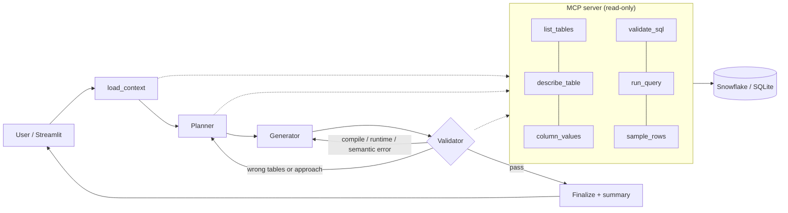

# Agentic Text-to-SQL Analytics Assistant

Ask questions about a 12-table retail warehouse in plain English and get validated SQL, results, a chart and a short answer. Three agents work together: a **planner**, a **SQL generator** and a **validator**. They are orchestrated with **LangGraph**, reach the warehouse through an **MCP** server, run on **Snowflake** (or a local SQLite copy) and sit behind a **Streamlit** UI. When the validator rejects a query, the system **self-corrects**: it sends the failure back to the generator, or to the planner if the whole approach is wrong.

## Architecture



| Agent | What it does | Tools it uses |
|---|---|---|
| **Planner** | Picks tables, joins, filters, metrics and grain from a compact catalog of all 12 tables. Asks to look up real column values it needs (e.g. `orders.status`). | `describe_table`, `column_values` |
| **Generator** | Writes one dialect-specific SELECT from the plan and the grounded schema. On retries it also sees the last 3 failed attempts with their feedback. | none (pure LLM) |
| **Validator** | Runs three gates: (1) read-only guard plus compile via `EXPLAIN`; (2) execution; (3) an LLM semantic review of the SQL and a preview of the result (wrong filter, fan-out double counting, empty or absurd output). Routes to `generator` (fix SQL) or `planner` (re-plan). | `validate_sql`, `run_query` |

Guardrails: single-statement SELECT/WITH only (regex guard on comment- and string-stripped SQL), a read-only SQLite connection (`mode=ro` + `query_only`), a read-only Snowflake role, query timeouts and row limits. Retries are capped (`AGENT_MAX_ATTEMPTS`, plus at most one re-plan). If no query is approved within the cap, the app shows the last query that ran and flags it as unverified.

## Quick start (local, no Snowflake needed)

```bash
python -m venv .venv && source .venv/bin/activate
pip install -r requirements.txt
cp .env.example .env              # add your ANTHROPIC_API_KEY
python -m warehouse.seed          # builds data/warehouse.db (12 tables, ~58k rows)
streamlit run app.py
```

CLI:

```bash
python -m agent.graph "What are the top 5 product categories by revenue in 2025?" --trace
```

Tests (no API key needed; a scripted fake LLM drives the real MCP server):

```bash
pytest -q
```

## Running for free with a cloud free tier (Groq or Gemini)

1. Get a free key: Groq at https://console.groq.com/keys (no credit card) or Google AI Studio at https://aistudio.google.com/apikey.
2. In `.env`, set `LLM_PROVIDER=groq` and `GROQ_API_KEY=...` (or `LLM_PROVIDER=gemini` and `GEMINI_API_KEY=...`).

Free tiers cap requests and tokens per minute and per day. The client waits and retries automatically when a limit is hit, so some questions pause briefly. The full 40-question eval may exceed one day's quota, so run it in parts with `--limit` / `--ids`.

## Running for free with a local model (Ollama)

1. Install Ollama from https://ollama.com and open it.
2. Download a coding model: `ollama pull qwen2.5-coder:7b` (about 4.7 GB; with 16 GB+ RAM, `qwen2.5-coder:14b` is more accurate).
3. In `.env`, set `LLM_PROVIDER=ollama` (and `OLLAMA_MODEL` if you pulled a different model).

Everything else works the same: app, CLI and eval. Local models are slower and less accurate than Claude, so expect lower absolute accuracy. The baseline-vs-agent comparison is still meaningful.

## Running on Snowflake

1. Fill in the `SNOWFLAKE_*` values in `.env`.
2. Create a read-only role for the agent (run as an admin):

   ```sql
   CREATE ROLE IF NOT EXISTS TEXT2SQL_READER;
   GRANT USAGE ON WAREHOUSE COMPUTE_WH TO ROLE TEXT2SQL_READER;
   GRANT USAGE ON DATABASE TEXT2SQL TO ROLE TEXT2SQL_READER;
   GRANT USAGE ON SCHEMA TEXT2SQL.RETAIL TO ROLE TEXT2SQL_READER;
   GRANT SELECT ON ALL TABLES IN SCHEMA TEXT2SQL.RETAIL TO ROLE TEXT2SQL_READER;
   GRANT SELECT ON FUTURE TABLES IN SCHEMA TEXT2SQL.RETAIL TO ROLE TEXT2SQL_READER;
   GRANT ROLE TEXT2SQL_READER TO USER <your_user>;
   ```

3. Load the same synthetic data (uses `SNOWFLAKE_ADMIN_ROLE`): `python -m warehouse.load_snowflake`
4. Set `WAREHOUSE_BACKEND=snowflake` and restart the app. The agents switch to Snowflake dialect notes automatically.

## Evaluation

`eval/questions.json` holds 40 questions (10 easy, 18 medium, 12 hard), each with hand-written reference SQL. They include deliberate traps: cancelled-order exclusion, join fan-out between `order_items` and `payments`, self-joins, window functions, and relative dates ("last quarter").

```bash
python -m eval.run_eval                         # baseline, no_semantic, agent
python -m eval.run_eval --modes baseline,agent --verbose
```

| Mode | Description |
|---|---|
| `baseline` | One LLM call with the full schema. No planning, no validation. |
| `no_semantic` | Planner + generator + self-correction on compile/runtime errors only. |
| `agent` | Full system, including the LLM semantic validator. |

The baseline gets the **same business rules and dialect notes** as the agent, so any gain comes from the architecture rather than from extra information.

Scoring is **execution accuracy**: a prediction is correct if it returns the same rows as the reference query. Column names and column order are ignored, extra columns are allowed, numbers match within rounding tolerance, and row order only counts for "top N" or ordered questions (see `eval/compare.py`). Reference answers are always computed on the local SQLite copy, which has identical data, so the eval can also score the agent running on Snowflake. Note that dialect-specific label formats (e.g. `DATE_TRUNC` month labels vs `'2025-01'`) can cost a few points there.

The output reports accuracy per mode and difficulty, average LLM calls and latency, how many questions needed self-correction, and the share of baseline errors removed. Results are saved to `eval/results/`.

## Project layout

```
app.py                  Streamlit UI (chat, results, auto-chart, agent trace)
config.py               Settings from .env
agent/
  graph.py              LangGraph wiring + run_question() / ask() + CLI
  nodes.py              load_context, planner, generator, validator, finalize, routing
  prompts.py            Agent prompts, business rules, dialect notes
  llm.py                Async Anthropic client with usage accounting
  mcp_client.py         MCP stdio client (spawns the server)
  baseline.py           Single-shot baseline for the eval
  state.py              Graph state
mcp_server/
  server.py             MCP server exposing warehouse tools
  db.py                 SQLite / Snowflake backends + read-only guard
warehouse/
  catalog.py            12-table schema with business descriptions and FKs
  seed.py               Deterministic synthetic data → SQLite
  load_snowflake.py     Same data → Snowflake (with column comments)
eval/
  questions.json        40 questions + reference SQL
  compare.py            Execution-accuracy matcher
  run_eval.py           Baseline vs agent evaluation
tests/                  Guard, warehouse, scorer, and agent-loop tests
```

## The data

Synthetic retail data for 2024-01-01 to 2025-12-31 with seasonality (Nov/Dec spikes, 2025 growth): `regions`, `stores`, `customers`, `categories`, `suppliers`, `products`, `employees` (with a manager hierarchy), `orders`, `order_items`, `payments` (including split payments), `shipments` and `returns`. Revenue is deliberately not stored on `orders`, so the agents have to compute it from line items, which is a realistic source of mistakes.
